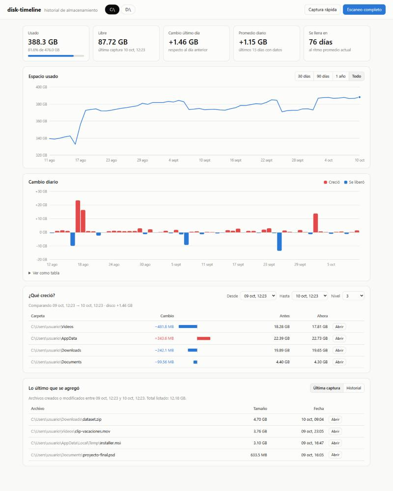

<div align="center">

# disk-timeline

**A day-by-day history of your disks: how much space gets used each day, and what used it.**

[](https://github.com/zFacuh/disk-timeline/actions/workflows/tests.yml)


[](LICENSE)

[Versión en español](README.md)

</div>

<picture>
  <source media="(prefers-color-scheme: dark)" srcset="docs/dashboard-oscuro.jpg">
  
</picture>

> The interface and command output are in Spanish. This page explains everything you need in English.

## What is it for?

Ever woken up to find `C:` 20 GB fuller with no idea why? **disk-timeline** takes a daily
snapshot of your disks and answers:

- 📈 **How is used space evolving?** A timeline chart per disk.
- 📊 **How much did it grow since yesterday?** Daily change in MB/GB, positive or negative.
- 🗂️ **Which folders grew?** Compare any two dates and see where the difference is.
- 🆕 **What was added most recently?** The largest new files, with their dates.
- ⏳ **When will it be full?** An estimate based on the average growth rate.

Everything runs locally: nothing is sent to the internet, no account, no admin rights and no
third-party dependencies. Just Python.

## Quick start

```powershell
pip install git+https://github.com/zFacuh/disk-timeline.git
disk-timeline snapshot                    # first snapshot (1-2 minutes)
disk-timeline schedule install            # automatic daily snapshot at 21:00
disk-timeline serve                       # open the dashboard in your browser
```

From the second day on you'll see daily growth and which folders changed.

**Requirements:** Windows 10/11 and [Python 3.10+](https://www.python.org/downloads/) (tick
*"Add python.exe to PATH"* when installing). Linux/macOS work with some limitations (see FAQ).

If `disk-timeline` is not recognized as a command, Python's `Scripts` folder is not on your
PATH; use `python -m disk_timeline <command>` instead.

## Usage

### Snapshots

```powershell
disk-timeline snapshot                    # full snapshot of every fixed disk
disk-timeline snapshot --quick            # usage only (used/free), instant, no scan
disk-timeline snapshot --drives C         # only C:
disk-timeline snapshot --depth 4          # record folder sizes 4 levels deep
disk-timeline snapshot --min-size 100MB   # only list new files of 100 MB or more
disk-timeline snapshot --exclude D:\VMs   # skip a folder
```

A **full snapshot** records disk usage, the size of every folder (3 levels deep by default)
and the largest files created or modified since the previous snapshot. A disk with ~1.1 million
files takes about a minute the first time and ~20 seconds afterwards.

### Console reports

```powershell
disk-timeline status C              # current usage and daily change for the last 14 days
disk-timeline growth C              # folders that changed the most between the last two full snapshots
disk-timeline growth C --from 12 --to 40 --depth 2
disk-timeline list C                # full snapshots with their ids
disk-timeline new C                 # largest new files in the latest snapshot
disk-timeline new C --all           # new files across all snapshots
```

### Web dashboard

```powershell
disk-timeline serve                 # http://127.0.0.1:8765
```

| Section | What it shows |
|---|---|
| **Tiles** | Used and free space, last day's change, daily average, days until full. |
| **Espacio usado** (used space) | Timeline with 30-day / 90-day / 1-year / all ranges and hover details. |
| **Cambio diario** (daily change) | Red bars when the disk grew, blue when space was freed. Also available as a table. |
| **¿Qué creció?** (what grew?) | Folders that changed the most between any two full snapshots. |
| **Lo último que se agregó** (latest additions) | Largest new files; **Abrir** reveals the file in Explorer. |

You can also trigger a quick or full snapshot from the dashboard. It follows the system's
light/dark theme, works offline and only listens on `127.0.0.1`.

### Automatic daily snapshots

```powershell
disk-timeline schedule install                 # every day at 21:00
disk-timeline schedule install --time 13:30
disk-timeline schedule install --quick         # usage-only snapshots
disk-timeline schedule show
disk-timeline schedule remove
```

This registers a Windows Task Scheduler task named `disk-timeline` that runs silently at low
priority, **runs as soon as the PC is turned on if it was off at the scheduled time**, also runs
on battery, and logs to `%LOCALAPPDATA%\disk-timeline\scheduled.log`.

## How it works

Each full snapshot walks the disk **once** and stores in a local SQLite database:

1. **Disk usage** (total/used/free), the same numbers Windows Explorer shows.
2. **Folder sizes** up to `--depth` levels. Comparing them across snapshots reveals which folders grew.
3. **Large new files**: created *or* modified since the previous snapshot. On Windows, copying
   or extracting a file gives it a new creation date, so those are detected too.

Symlinks and junctions are not followed, and files of 16 MB or more that are reachable through
several paths (hard links, redirected folders) are counted once. See
[docs/como-funciona.md](docs/como-funciona.md) (Spanish) for the database schema, the dashboard
API and design decisions.

## Data location

| What | Where |
|---|---|
| Database | `%LOCALAPPDATA%\disk-timeline\history.db` |
| Scheduled task log | `%LOCALAPPDATA%\disk-timeline\scheduled.log` |

Override with the `DISK_TIMELINE_HOME` (folder) or `DISK_TIMELINE_DB` (file) environment
variables, or the global `--db FILE` option. A full snapshot of one disk takes under 1 MB.

## FAQ

**Why doesn't the sum of folders match the disk's used space?** Used space includes things that
aren't visible files (MFT, restore points, folders you can't read). disk-timeline also counts
logical file size, which can differ from size on disk.

**What does "N sin acceso" mean?** N items couldn't be read without admin rights. Admin is not
required; running as admin just measures system folders more precisely.

**Are USB or network drives scanned?** Not by default, only fixed disks. Add one explicitly with
`--drives E`.

**Linux / macOS?** Snapshots, reports and the dashboard work (scanning `/`, or any mount point
via `--drives /home`). Scheduling and the "Abrir" button are Windows-only; use cron instead:
`0 21 * * * disk-timeline snapshot --quiet`.

**Can I try the dashboard without waiting days?** Yes:
`python scripts/make_demo_db.py demo.db` then `disk-timeline --db demo.db serve`.

## Uninstall

```powershell
disk-timeline schedule remove
pip uninstall disk-timeline
```

Delete `%LOCALAPPDATA%\disk-timeline` to remove the history as well.

## Contributing

Issues and pull requests are welcome, see [CONTRIBUTING.md](CONTRIBUTING.md). Run the tests with
`python -m unittest discover -s tests`.

## License

[MIT](LICENSE)
