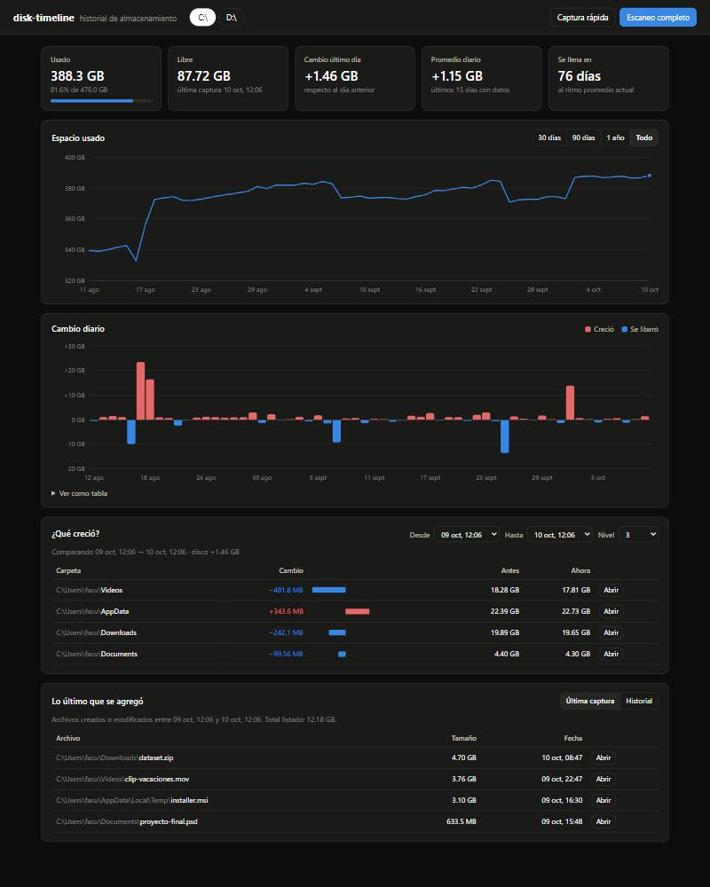

# disk-timeline

Historial del almacenamiento de tus discos: cuánto espacio ocupa cada disco día a día,
cuánto creció con respecto a los días anteriores y **qué fue lo último que se agregó**
que está consumiendo ese espacio.

- 📈 Gráfica temporal del espacio usado por disco.
- 📊 Crecimiento diario (MB/GB ganados o liberados por día).
- 🗂️ Qué carpetas crecieron entre dos fechas.
- 🆕 Archivos grandes nuevos o modificados desde la última captura.
- 🕘 Captura automática diaria con el Programador de tareas de Windows.

Sin dependencias externas: sólo Python 3.10+ (biblioteca estándar) y SQLite.
El panel funciona offline (gráficas SVG propias, sin CDNs).



## Instalación

```bash
git clone https://github.com/zfacuh/disk-timeline.git
cd disk-timeline
pip install -e .
```

También se puede usar sin instalar: `python -m disk_timeline ...`

## Uso

```bash
# Tomar una captura completa de todos los discos fijos (escanea carpetas y archivos nuevos)
disk-timeline snapshot

# Sólo registrar el espacio usado/libre (instantáneo, sin escanear)
disk-timeline snapshot --quick

# Sólo algunos discos
disk-timeline snapshot --drives C D

# Resumen en consola: uso actual y crecimiento diario
disk-timeline status

# Qué carpetas crecieron entre las dos últimas capturas completas del disco C
disk-timeline growth C

# Archivos nuevos/modificados más grandes detectados en la última captura
disk-timeline new C

# Abrir el panel web con las gráficas (http://127.0.0.1:8765)
disk-timeline serve

# Programar una captura diaria automática (por defecto a las 21:00)
disk-timeline schedule install --time 21:00
disk-timeline schedule remove
```

## Cómo funciona

Cada captura (`snapshot`) guarda en una base SQLite:

1. **Uso del disco**: total, usado y libre.
2. **Tamaño de carpetas** hasta una profundidad configurable (`--depth`, por defecto 3),
   por ejemplo `C:\Users\facu\Downloads`. Comparando dos capturas se ve qué carpetas crecieron.
3. **Archivos nuevos**: archivos creados o modificados desde la captura anterior y que
   superan un tamaño mínimo (`--min-size`, por defecto 10 MB). Se guardan los más grandes
   (`--top`, por defecto 200).

En Windows la fecha de creación cambia al copiar un archivo, así que también se detectan
archivos copiados o descomprimidos aunque conserven una fecha de modificación antigua.

La base de datos se guarda en `%LOCALAPPDATA%\disk-timeline\history.db`
(se puede cambiar con la variable de entorno `DISK_TIMELINE_HOME`).

## Panel web

`disk-timeline serve` abre un panel local (sólo escucha en `127.0.0.1`) con:

- **Indicadores**: usado, libre, cambio del último día, promedio diario y en cuántos días
  se llenaría el disco al ritmo actual.
- **Espacio usado** en el tiempo (30 días, 90 días, 1 año o todo).
- **Cambio diario**: barras rojas cuando creció, azules cuando se liberó espacio.
- **¿Qué creció?**: carpetas comparando dos capturas completas cualesquiera.
- **Lo último que se agregó**: archivos grandes nuevos, con botón para abrirlos en el Explorador.
- Botones para tomar una captura rápida o un escaneo completo desde el panel.

## Opciones útiles

| Opción | Descripción |
|---|---|
| `--db ARCHIVO` | usar otra base de datos (va antes del comando: `disk-timeline --db x.db status`) |
| `snapshot --depth N` | profundidad de carpetas registradas (por defecto 3) |
| `snapshot --min-size 50MB` | tamaño mínimo para listar un archivo como nuevo |
| `snapshot --exclude D:\VMs` | ignorar carpetas al escanear |
| `schedule install --quick` | programar sólo capturas rápidas (sin escaneo) |

## Desarrollo

```bash
python -m unittest discover -s tests

# Probar el panel con 60 días de historial simulado
python scripts/make_demo_db.py demo.db
python -m disk_timeline --db demo.db serve
```

## Licencia

MIT
